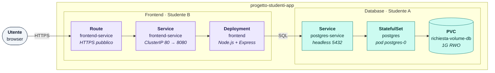
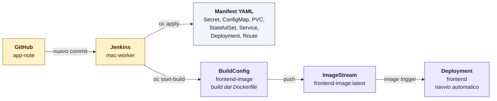
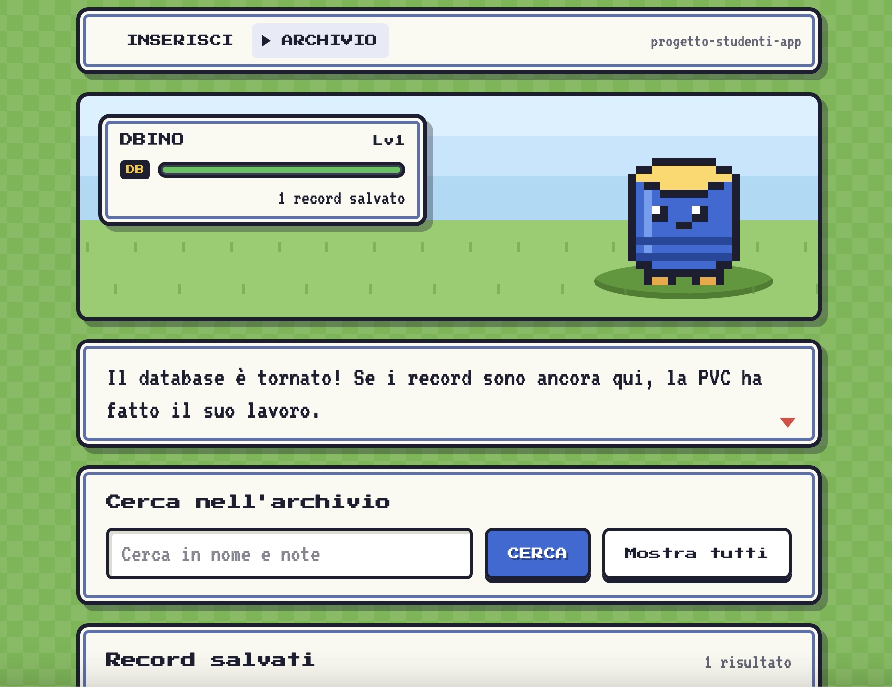
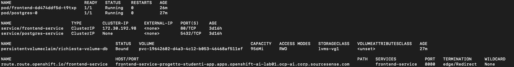

# app-note

Applicazione web a due livelli (frontend Node.js + database PostgreSQL) distribuita su **OpenShift**, con build e deploy automatizzati da una pipeline **Jenkins**.

Progetto realizzato per l'esercizio pratico *"OpenShift: Architettura Multi-Pod & Persistenza"*.

---

## Indice

1. [Obiettivi](#obiettivi)
2. [Architettura](#architettura)
3. [Divisione dei compiti](#divisione-dei-compiti)
4. [Struttura della repository](#struttura-della-repository)
5. [Frontend](#frontend)
6. [Database](#database)
7. [Secret e credenziali](#secret-e-credenziali)
8. [Pipeline Jenkins](#pipeline-jenkins)
9. [Deploy manuale (senza Jenkins)](#deploy-manuale-senza-jenkins)
10. [Test e verifica](#test-e-verifica)
11. [Risultati](#risultati)
12. [Problemi incontrati e soluzioni](#problemi-incontrati-e-soluzioni)

---

## Obiettivi

- Creare e configurare un progetto/namespace dedicato su OpenShift (`progetto-studenti-app`).
- Gestire la comunicazione interna tra pod tramite **Service**.
- Esporre l'applicazione all'esterno tramite **Route**.
- Garantire la persistenza dei dati tramite **PersistentVolumeClaim**.
- Lavorare in coppia con ruoli separati (Studente A: database, Studente B: applicazione e networking).

---

## Architettura




1. Il browser apre l'indirizzo pubblico della **Route** (HTTPS).
2. La Route passa la richiesta al **Service** `frontend-service`.
3. Il Service la consegna al pod del **Deployment** `frontend`, dove gira `server.js`.
4. `server.js` invia la query SQL al **Service** `postgres-service`.
5. Il Service la inoltra al pod `postgres-0` dello **StatefulSet**.
6. PostgreSQL scrive i dati sulla **PVC**, che sopravvive alla cancellazione del pod.

Entrambi i pod ricevono le credenziali dal Secret `db-secret` e host/porta del database dalla ConfigMap `db-conf`.

---

## Divisione dei compiti

| | Studente A – Database & Storage | Studente B – Applicazione & Networking |
|---|---|---|
| **Risorse** | Progetto e permessi, PVC, StatefulSet PostgreSQL, Service del DB, ConfigMap, Secret | Web app, Dockerfile, build dell'immagine, Deployment, Service, Route, pipeline Jenkins |
| **File** | `00-db-pvc.yaml`, `01-db-statefulset.yaml`, `02-db-service.yaml`, `03-db-configmap.yaml`, Secret | `frontend/`, `04-app-deployment.yaml`, `05-frontend-service.yaml`, `06-route-frontend.yaml`, `Jenkinsfile` |

---

## Struttura della repository

```
app-note/
├── Jenkinsfile                     # pipeline: login, apply dei manifest, build dell'immagine
├── frontend/
│   ├── Dockerfile                  # immagine Node.js compatibile con OpenShift
│   ├── package.json                # dipendenze: express, pg
│   ├── server.js                   # server web + API REST verso PostgreSQL
│   └── public/
│       ├── index.html              # Pagina 1 – inserimento (Nome, Note, Salva)
│       ├── search.html             # Pagina 2 – ricerca ed eliminazione
│       ├── style.css               # grafica in stile RPG retrò
│       └── common.js               # funzioni condivise tra le due pagine
└── openshift/
    ├── 00-db-pvc.yaml              # PersistentVolumeClaim del database
    ├── 01-db-statefulset.yaml      # StatefulSet PostgreSQL 15
    ├── 02-db-service.yaml          # Service headless del database
    ├── 03-db-configmap.yaml        # host e porta del database
    ├── 04-app-deployment.yaml      # Deployment del frontend
    ├── 05-frontend-service.yaml    # Service ClusterIP del frontend
    └── 06-route-frontend.yaml      # Route HTTPS verso l'esterno
```

Il Secret `db-secret` **non è nella repository**: vedi [Secret e credenziali](#secret-e-credenziali).

---

## Frontend

### Le due pagine

| Pagina | Indirizzo | Funzione |
|---|---|---|
| **Inserimento** | `/` , `/index.html` , `/insert` | form con i campi *Nome* (obbligatorio) e *Note*; il pulsante **SALVA** inserisce il record |
| **Gestione** | `/search.html` , `/manage` | elenco dei record, ricerca per testo su nome e note, pulsante **ELIMINA** con conferma |

In alto in entrambe le pagine c'è un pannello di stato: la barra "HP" mostra in tempo reale se il database è raggiungibile (verde = online, rossa = offline). È utile durante il crash test.

### API REST (server.js)

| Metodo | Endpoint | Query SQL | Descrizione |
|---|---|---|---|
| `POST` | `/api/records` | `INSERT` | crea un record (`{ "nome": "...", "note": "..." }`) |
| `GET` | `/api/records?q=testo` | `SELECT ... ILIKE` | cerca il testo in nome e note, senza distinzione tra maiuscole e minuscole |
| `DELETE` | `/api/records/:id` | `DELETE` | elimina un record |
| `GET` | `/api/status` | `SELECT COUNT(*)` | stato del database e numero di record |
| `GET` | `/healthz` | – | usato dalle probe di OpenShift |


### Variabili d'ambiente

Il server accetta sia nomi generici `DB_*` sia quelli dell'immagine PostgreSQL. Per ogni parametro usa la prima variabile presente:

| Parametro | Variabili | Default |
|---|---|---|
| Host |  `POSTGRES_HOST` | `db-service` |
| Porta |  `POSTGRES_PORT` | `5432` |
| Utente |  `POSTGRES_USER` | – |
| Password | `POSTGRES_PASSWORD` | – |
| Database | `POSTGRES_DB`| – |
| Porta HTTP | `PORT` | `8080` |

### Dockerfile

```dockerfile
FROM node:22-alpine                         # Linux minimale con Node 22
ENV NODE_ENV=production PORT=8080
WORKDIR /app
COPY package.json ./
RUN npm install --omit=dev && npm cache clean --force   # solo dipendenze di produzione
COPY server.js ./
COPY public ./public
RUN chgrp -R 0 /app && chmod -R g=u /app    # compatibilità con l'UID casuale di OpenShift
USER 1001                                   # mai come root
EXPOSE 8080                                 # porta non privilegiata
CMD ["node", "server.js"]                   # node riceve direttamente SIGTERM
```

OpenShift avvia i container con un **UID casuale** appartenente al gruppo `0`. La riga `chgrp`/`chmod` dà al gruppo 0 gli stessi permessi del proprietario, così l'app funziona con qualunque UID.

---

## Database

| Risorsa | Nome | Dettagli |
|---|---|---|
| PersistentVolumeClaim | `richiesta-volume-db` | 1G, `ReadWriteOnce`, montata su `/var/lib/postgresql/data` |
| StatefulSet | `postgres` | immagine `postgres:15`, 1 replica, pod `postgres-0`, etichetta `app: postgres` |
| Service | `postgres-service` | **headless** (`clusterIP: None`), porta 5432 |
| ConfigMap | `db-conf` | `POSTGRES_HOST=postgres-service`, `POSTGRES_PORT=5432` |
| Secret | `db-secret` | credenziali del database |

**Perché uno StatefulSet:** è la risorsa pensata per le applicazioni con stato come i database. Il pod ha un nome stabile (`postgres-0`) e, quando viene ricreato, rimonta sempre la stessa PVC.

**Perché `PGDATA` in una sottocartella:** il volume montato può contenere file di sistema (es. `lost+found`) e PostgreSQL rifiuta di inizializzarsi in una cartella non vuota. Con `PGDATA=/var/lib/postgresql/data/pgdata` i dati finiscono in una sottocartella pulita, sempre all'interno della PVC.

---

## Secret e credenziali

Il Secret `db-secret` contiene password e non viene salvato su Git. È conservato in Jenkins come credenziale di tipo *Secret file* (ID `postgres-db-secret`) e applicato dalla pipeline con `oc apply`.

---

## Pipeline Jenkins



La pipeline (`Jenkinsfile`) gira sull'agent `mac-worker` e controlla la repository ogni ora (`pollSCM('H * * * *')`): parte solo quando trova nuovi commit.

| Stage | Cosa fa |
|---|---|
| **Login & Test OpenShift** | login al cluster con il token del service account, selezione del progetto, `oc apply` del Secret e di tutti i manifest in `openshift/` |
| **Frontend: crea BuildConfig** | crea la BuildConfig `frontend-image` (binary build, strategia Docker) solo se non esiste già |
| **Frontend: build e push immagine** | `oc start-build --from-dir=frontend`: carica la cartella sul cluster, OpenShift costruisce l'immagine dal Dockerfile e la salva nell'Internal Registry; poi aggiunge il tag `build-<numero>` |
| **Verifica** | stampa `oc get pods,svc,pvc,route` e l'ImageStream |

### Credenziali da configurare in Jenkins

| ID | Tipo | Contenuto |
|---|---|---|
| `openshift-sa-token` | Secret text | token di un service account con ruolo `edit` su `progetto-studenti-app` |
| `postgres-db-secret` | Secret file | il manifest YAML del Secret `db-secret` |

Sull'agent deve essere installato il client `oc`.

---

## Test e verifica

### Pagina 2 funzionante



### Output di `oc get pods,svc,pvc,route`

```
$ oc get pods,svc,pvc,route
```



---

## Problemi incontrati e soluzioni

| Problema | Causa | Soluzione |
|---|---|---|
| `npm ci` falliva nella build | `npm ci` richiede `package-lock.json`, che era stato rimosso | sostituito con `npm install --omit=dev` nel Dockerfile |
| Frontend: `getaddrinfo ENOTFOUND db-service` | l'app cercava `db-service`, ma il Service del DB si chiama `postgres-service` | `server.js` legge anche le variabili `POSTGRES_*`; l'host arriva da `POSTGRES_HOST` |
| Database creato con il nome sbagliato | l'immagine `postgres` ignora `POSTGRES_NAME`: riconosce solo `POSTGRES_DB` | la chiave `POSTGRES_NAME` del Secret viene esposta come variabile `POSTGRES_DB` |
| DB: `role "..." does not exist` | PostgreSQL crea l'utente solo alla **prima** inizializzazione; la PVC conteneva già dati creati con un utente diverso | eliminati StatefulSet e PVC e ricreati, così l'inizializzazione è ripartita con i valori corretti del Secret |